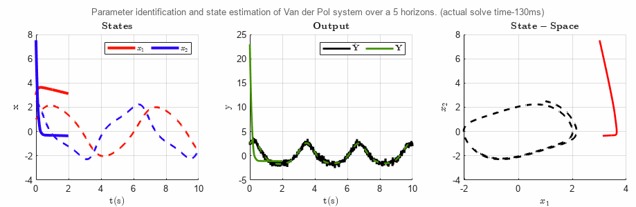

# Spline-MHE
[](https://www.mathworks.com/campaigns/products/trials.html?prodcode=ML&s_tid=prod_getml)




`Spline-MHE` is a **Smoothing Spline Nonlinear Moving Horizon Estimation** framework for fast and consistently convergent parameter identification and initial-state estimation of nonlinear dynamic systems of the form,
```math
\begin{aligned}\dot{x}( t) =f( x( t) ,u(t),\theta ),\\ y( t) =g( x( t) ,u(t),\theta ), \end{aligned}
```
where:
* $x(t)\in \mathbb{R}^{n_{x}}$ is the $n_{x}$ dimensional state vector,
* $y(t)\in \mathbb{R}^{n_{y}}$ is the $n_{y}$ dimensional output vector, and
* $\theta \in \mathbb{R}^{n_{\theta }}$ is the $n_{\theta}$ dimensional model parameter vector.

`Spline-MHE` approximates the model output and state trajectories over a moving horizon using **smoothing splines** to perform spline matching with the smoothing spline approximation of observed noisy data. The `Spline-MHE` NLP is formulated in a **multiple-shooting** framework, with a loss function that enforces higher-order output-derivative matching using exact spline derivatives, enabling robust parameter and initial-state estimates while remaining fast, tractable, and consistently convergent for large and highly nonlinear systems.


# Installation
`Spline-MHE` uses [`CasADi`](https://web.casadi.org/get/) for construction of NLP Hessian and Jacobian matrices and [`IPOPT`](https://www.mathworks.com/matlabcentral/fileexchange/53040-ebertolazzi-mexipopt?s_tid=FX_rc2_behav) for MATLAB to solve the NLP using interior-point optimization. Running the examples automatically adds all necessary support functions to your MATLAB path.
