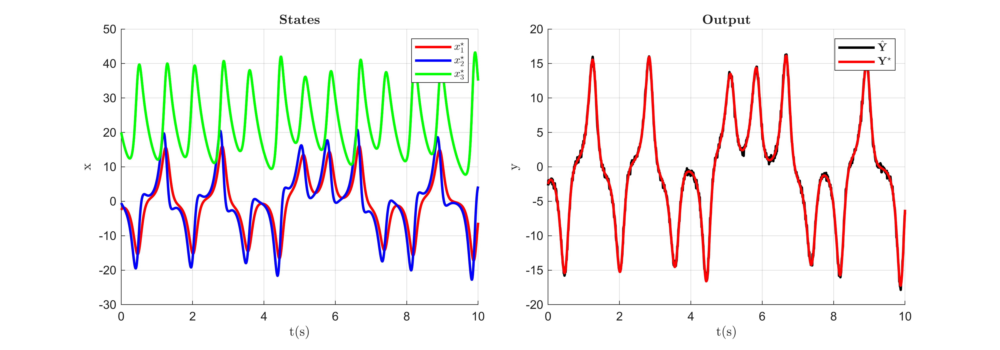
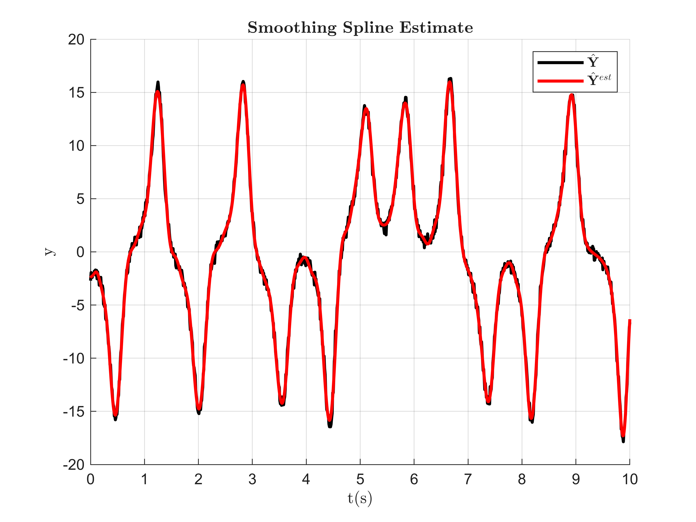
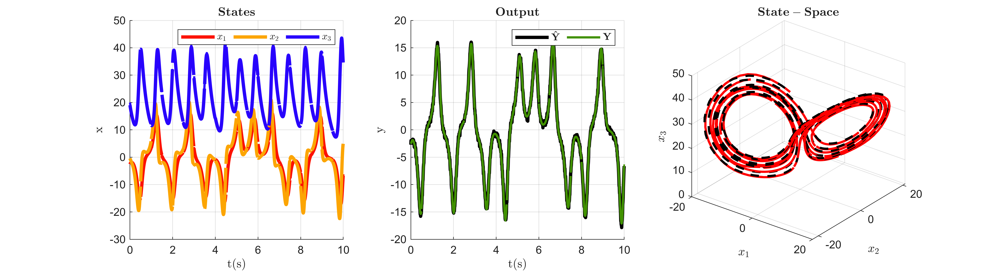

# Lorenz Multiple Parameter Identification

The Lorenz system considered in this example is defined as,

 $$ {\dot{x} }_1 (t)=\theta_1 (x_2 (t)-x_1 (t)), $$ 

 $$ {\dot{x} }_2 (t)=x_1 (t)(\theta_2 -x_3 (t))-x_2 (t), $$ 

 $$ {\dot{x} }_3 (t)=x_1 (t)x_2 (t)-\theta_3 x_3 (t), $$ 

 $$ y(t)=x_1 (t), $$ 

where the states $x(t)\in {\mathbb{R}}^3$ and the parameters $\theta \in {\mathbb{R}}^3$ . In this example the underlying true system is initialized at initial states $x^{\star } (0)=[-2.5;-0.5;20]$ and parameters $\theta^{\star } =[10;28;8/3]$ characterizing the true system as chaotic. The goal of this example is to use Spline\-MHE algorithm to use the true model output $y(t)=x_1 (t)$ corrupted with Gaussian noise to estimate the model initial states $x^{\ast } (0)$ and identify the model parameters $\theta^{\ast }$ .

### Generate Noisy Data

The following code generates and plots the output trajectory from the true model and corrupts it with Gaussian noise:

```matlab
clear
global iteration_data Sol;
addpath("Support_Functions\");

T = 10; % simulation time
N = 1000; % number of time step intervals
dt = T/N; % time step size

n_x = 3;
n_y = 1;
n_theta = 3;

% True Initial condition and parameter values
x0_star = [-2.5;-0.5;20];
theta_star = [10;28;8/3];

true_param = {x0_star,theta_star};

% Simulate true model
[x_star,y_star,Y_hat] = Lorenz_sim(true_param,N,dt,10,true); % SNR=10
```


### Initialize Spline\-MHE

For initializing the Spline\-MHE algorithm, the initial guess of $x(0)$ and $\theta$ , the smoothing spline estimate of noisy data ${{\hat{Y} }}^{est}$ , along with the hyperparameter choices are required. Here the initial $x(0)$ and $\theta$ are arbitrarily chosen by linearly scaling $x^{\star } (0)$ and $\theta^{\star }$ using scaling factors $r_x$ and $r_{\theta }$ . The Spline\-MHE hyperparameter can then be selected based on the heuristics presented in the paper. For demonstration purposes, the hyperparameter choices for number of moving horizons $n_h =1$ , number of multiple shooting spline segments over a horizon $n_s =20$ , spline order $n_p =3$ , number of knots per spline segment $n_{\tau } =8$ , the set of intermediate constraint points $\mathcal{K}$ , and a weighting matrix ${W=I}$ are chosen for this example. The smoothing spline estimate ${{\hat{Y} }}^{est} =\big(\Phi \Phi_{\lambda ,\delta }^{\dagger} {{\hat{Y} }}^{\top } {\left.\big)}^{\top } \right.$ of the noisy data for $\Phi_{\lambda ,\delta }^{\dagger} =\big(\Phi^{\top } \Phi +\lambda \Phi^{(\delta )\top } \Phi^{(\delta )} {\left.\big)}^{-1} \Phi^{\top } \right.$ is obtained by first finding a minimizing value of the smoothness factor $\lambda$ for a chosen spline derivative order $\delta$ using a Generalized Cross\-Validation (GCV) scheme. The following code initializes the Spline\-MHE algorithm:

```matlab
% Initial state and parameter Scaling factors 
r_x = 2;
r_theta = 2;

x0_init = x0_star*r_x; % x(0) initial guess
theta_init = theta_star*r_theta; % theta initial guess

% Spline-MHE hyperparameter selection
nh = 1; % number of moving horizons
ns = 20; % number of multiple-shooting spline segments per horizon

np = 3; % spline order
n_tau = 8; % number of spline knots

%(Note: ns*nh must be a multiple of N)
Ns = N/(ns*nh); % number of discrete points within a spline segment

Kappa = ceil(linspace(1,Ns,(np+(n_tau-2)))); % Intermediate constraint point set

% Smoothing spline estimate using GCV for lambda
delta = 2; % spline derivative order
[lambda,Y_hat_est] = GCV(Y_hat,delta,np*2,n_tau*10,N,dt,true);
```


### Solve Spline\-MHE

The initial guess of $x(0)$ and $\theta$ , the smoothing spline estimate ${{\hat{Y} }}^{est}$ , and the Spline\-MHE hyperparameter choices can now be used to solve the Spline\-MHE NLP to estimate the model initial states $x^{\ast } (0)$ and identify the model parameters $\theta^{\ast }$ . The following code solves the Spline\-MHE NLP:

```matlab
Sol = SplineMHE_Lorenz(x0_init,theta_init,Y_hat_est,delta,Kappa,N,dt,ns,nh,np,n_tau)
```

```matlabTextOutput
      solver  :   t_proc      (avg)   t_wall      (avg)    n_eval
callback_fun  | 115.00ms (  3.59ms) 114.23ms (  3.57ms)        32
       nlp_f  |  13.00ms (342.11us)  17.22ms (453.11us)        38
       nlp_g  |   9.00ms (236.84us)   8.47ms (222.79us)        38
  nlp_grad_f  |  27.00ms (818.18us)  23.48ms (711.42us)        33
  nlp_hess_l  | 254.00ms (  8.19ms) 252.97ms (  8.16ms)        31
   nlp_jac_g  |  87.00ms (  2.64ms)  86.58ms (  2.62ms)        33
       total  | 761.00ms (761.00ms) 761.27ms (761.27ms)         1
```
| |Horizon-1|
|:--:|:--:|
|1 x*(0)|[-2.5531;-0.4111;19.0338]|
|2 θ*|[9.9125;27.4779;2.7031]|
|3 Convergence Cost|0.0430|
|4 Solver Iterations|31|
|5 NLP Construction Time (s)|0.4700|
|6 NLP Solve Time (s)|0.7613|


The following code animates the solver iterations:

```matlab
animate_Lorenz(iteration_data,x_star,y_star,Y_hat,N,dt,nh,ns,n_x,n_y);
```


