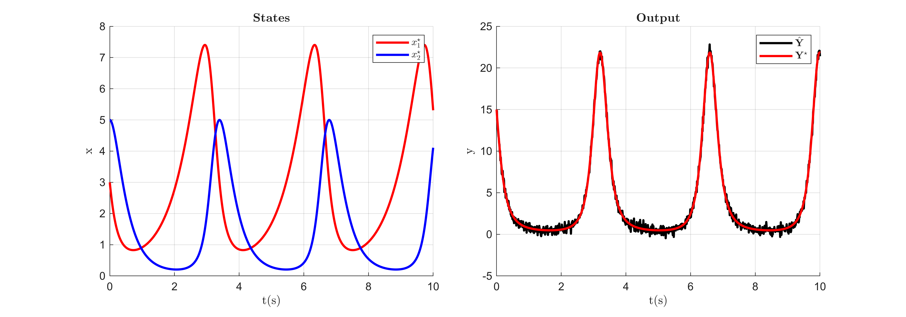
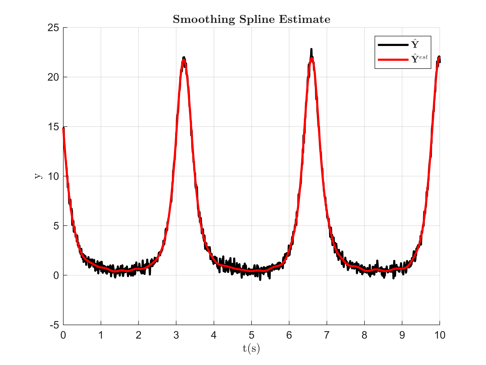
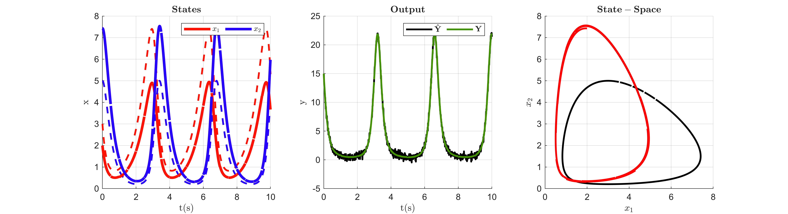

# Lotka\-Volterra Multiple Parameter Identification

The Lotka\-Volterra system considered in this example is defined as,

 $$ {\dot{x} }_1 (t)=\theta_1 x_1 (t)-\theta_2 x_1 (t)x_2 (t), $$ 

 $$ {\dot{x} }_2 (t)=-\theta_3 x_2 (t)+\theta_4 x_1 (t)x_2 (t), $$ 

 $$ y(t)=x_1 (t)x_2 (t), $$ 

where the states $x(t)\in {\mathbb{R}}^2$ and the parameters $\theta \in {\mathbb{R}}^4$ . In this example the underlying true system is initialized at initial states $x^{\star } (0)=[3;5]$ and parameters $\theta^{\star } =[1.5;1;3;1]$ . The goal of this example is to use Spline\-MHE algorithm to use the true model output $y(t)=x_1 (t)x_2 (t)$ corrupted with Gaussian noise to estimate the model initial states $x^{\ast } (0)$ and identify the model parameters $\theta^{\ast }$ .

### Generate Noisy Data

The following code generates and plots the output trajectory from the true model and corrupts it with Gaussian noise:

```matlab
clear
global iteration_data Sol;
addpath("Support_Functions\");

T = 10; % simulation time
N = 1000; % number of time step intervals
dt = T/N; % time step size

n_x = 2;
n_y = 1;
n_theta = 4;

% True Initial condition and parameter values
x0_star = [3;5];
theta_star = [1.5;1;3;1];

true_param = {x0_star,theta_star};

% Simulate true model
[x_star,y_star,Y_hat] = Volterra_sim(true_param,N,dt,10,true); % SNR=10
```


### Initialize Spline\-MHE

For initializing the Spline\-MHE algorithm, the initial guess of $x(0)$ and $\theta$ , the smoothing spline estimate of noisy data ${{\hat{Y} }}^{est}$ , along with the hyperparameter choices are required. Here the initial $x(0)$ and $\theta$ are arbitrarily chosen by linearly scaling $x^{\star } (0)$ and $\theta^{\star }$ using scaling factors $r_x$ and $r_{\theta }$ . The Spline\-MHE hyperparameter can then be selected based on the heuristics presented in the paper. For demonstration purposes, the hyperparameter choices for number of moving horizons $n_h =1$ , number of multiple shooting spline segments over a horizon $n_s =20$ , spline order $n_p =3$ , number of knots per spline segment $n_{\tau } =8$ , the set of intermediate constraint points $\mathcal{K}$ , and weighting matrix ${W=0.1I}$ and ${\bar{W} =20I}$ are chosen for this example. The smoothing spline estimate ${{\hat{Y} }}^{est} ={\big(\Phi \Phi_{\lambda ,\delta }^{\dagger} {{\hat{Y} }}^{\top } \big)}^{\top }$ of the noisy data for $\Phi_{\lambda ,\delta }^{\dagger} ={\big(\Phi^{\top } \Phi +\lambda \Phi^{(\delta )\top } \Phi^{(\delta )} \big)}^{-1} \Phi^{\top }$ is obtained by first finding a minimizing value of the smoothness factor $\lambda$ for a chosen spline derivative order $\delta$ using a Generalized Cross\-Validation (GCV) scheme. The following code initializes the Spline\-MHE algorithm:

```matlab
% Initial state and parameter Scaling factors 
r_x = 2;
r_theta = 2;

x0_init = x0_star*r_x; % x(0) initial guess
theta_init = theta_star*r_theta; % theta initial guess

% Spline-MHE hyperparameter selection
nh = 1; % number of moving horizons
ns = 20; % number of multiple-shooting spline segments per horizon

np = 3; % spline order
n_tau = 8; % number of spline knots

%(Note: ns*nh must be a multiple of N)
Ns = N/(ns*nh); % number of discrete points within a spline segment

Kappa = ceil(linspace(1,Ns,(np+(n_tau-2)))); % Intermediate constraint point set

% Smoothing spline estimate using GCV for lambda
delta = 2; % spline derivative order
[lambda,Y_hat_est] = GCV(Y_hat,delta,np*2,n_tau*7,N,dt,true);
```


### Solve Spline\-MHE

The initial guess of $x(0)$ and $\theta$ , the smoothing spline estimate ${{\hat{Y} }}^{est}$ , and the Spline\-MHE hyperparameter choices can now be used to solve the Spline\-MHE NLP to estimate the model initial states $x^{\ast } (0)$ and identify the model parameters $\theta^{\ast }$ . The following code solves the Spline\-MHE NLP:

```matlab
Sol = SplineMHE_Volterra(x0_init,theta_init,Y_hat_est,delta,Kappa,N,dt,ns,nh,np,n_tau)
```

```matlabTextOutput
      solver  :   t_proc      (avg)   t_wall      (avg)    n_eval
callback_fun  |  62.00ms (  1.38ms)  64.85ms (  1.44ms)        45
       nlp_f  |  22.00ms (423.08us)  23.33ms (448.60us)        52
       nlp_g  |   8.00ms (150.94us)  10.26ms (193.55us)        53
  nlp_grad_f  |  28.00ms (608.70us)  29.76ms (646.87us)        46
  nlp_hess_l  | 295.00ms (  6.70ms) 290.68ms (  6.61ms)        44
   nlp_jac_g  |  88.00ms (  1.91ms)  84.95ms (  1.85ms)        46
       total  | 775.00ms (775.00ms) 774.14ms (774.14ms)         1
```
| |Horizon-1|
|:--:|:--:|
|1 x*(0)|[1.9956;7.4283]|
|2 θ*|[1.5893;0.6845;2.8168;1.4503]|
|3 Convergence Cost|0.0044|
|4 Solver Iterations|44|
|5 NLP Construction Time (s)|0.2998|
|6 NLP Solve Time (s)|0.7741|


The following code animates the solver iterations. Note that since this is a unobservable\-unidentifiable (UOI) system, there are infinite solutions that yield the exact same output response. It can be seen in the animation that Spline\-MHE was able to converge on a solution that produces the required output response:

```matlab
animate_Volterra(iteration_data,x_star,y_star,Y_hat,N,dt,nh,ns,n_x,n_y);
```


