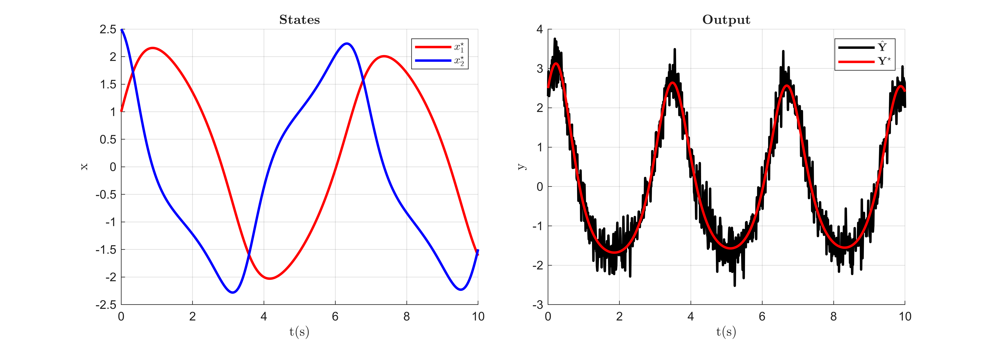
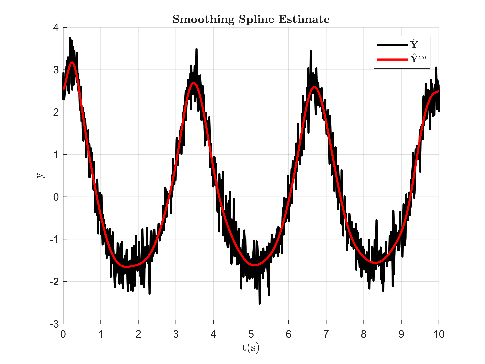
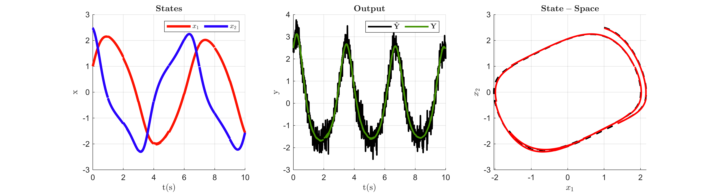

# Van der Pol Parameter Identification

The Van der Pol system considered in this example is defined as,

 $$ {\dot{x} }_1 (t)=x_2 (t), $$ 

 $$ {\dot{x} }_2 (t)=-x_1 (t)+\theta_1 (1-x_1^2 (t))x_2 (t), $$ 

 $$ y(t)=x_1 (t)x_2 (t), $$ 

where the states $x(t)\in {\mathbb{R}}^2$ and the parameters $\theta \in {\mathbb{R}}^1$ . In this example the underlying true system is initialized at initial states $x^{\star } (0)=[1;2.5]$ and parameters $\theta^{\star } =[0.5]$ characterizing the true system as chaotic. The goal of this example is to use Spline\-MHE algorithm to use the true model output $y(t)=x_1 (t)x_2 (t)$ corrupted with Gaussian noise to estimate the model initial states $x^{\ast } (0)$ and identify the model parameters $\theta^{\ast }$ .

### Generate Noisy Data

The following code generates and plots the output trajectory from the true model and corrupts it with Gaussian noise:

```matlab
clear
global iteration_data Sol;
addpath("Support_Functions\");

T = 10; % simulation time
N = 1000; % number of time step intervals
dt = T/N; % time step size

n_x = 2;
n_y = 1;
n_theta = 1;

% True Initial condition and parameter values
x0_star = [1;2.5];
theta_star = [0.5];

true_param = {x0_star,theta_star};

% Simulate true model
[x_star,y_star,Y_hat] = VanderPol_sim(true_param,N,dt,10,true); % SNR=10
```


### Initialize Spline\-MHE

For initializing the Spline\-MHE algorithm, the initial guess of $x(0)$ and $\theta$ , the smoothing spline estimate of noisy data ${{\hat{Y} }}^{est}$ , along with the hyperparameter choices are required. Here the initial $x(0)$ and $\theta$ are arbitrarily chosen by linearly scaling $x^{\star } (0)$ and $\theta^{\star }$ using scaling factors $r_x$ and $r_{\theta }$ . The Spline\-MHE hyperparameter can then be selected based on the heuristics presented in the paper. For demonstration purposes, the hyperparameter choices for number of moving horizons $n_h =5$ , number of multiple shooting spline segments over a horizon $n_s =2$ , spline order $n_p =2$ , number of knots per spline segment $n_{\tau } =8$ , the set of intermediate constraint points $\mathcal{K}$ , and weighting matrix ${W=I}$ and ${\bar{W} =10I}$ are chosen for this example. The smoothing spline estimate ${{\hat{Y} }}^{est} ={\big(\Phi \Phi_{\lambda ,\delta }^{\dagger} {{\hat{Y} }}^{\top } \big)}^{\top }$ of the noisy data for $\Phi_{\lambda ,\delta }^{\dagger} ={\big(\Phi^{\top } \Phi +\lambda \Phi^{(\delta )\top } \Phi^{(\delta )} \big)}^{-1} \Phi^{\top }$ is obtained by first finding a minimizing value of the smoothness factor $\lambda$ for a chosen spline derivative order $\delta$ using a Generalized Cross\-Validation (GCV) scheme. The following code initializes the Spline\-MHE algorithm:

```matlab
% Initial state and parameter Scaling factors 
r_x = 3;
r_theta = 2;

x0_init = x0_star*r_x; % x(0) initial guess
theta_init = theta_star*r_theta; % theta initial guess

% Spline-MHE hyperparameter selection
nh = 5; % number of moving horizons
ns = 2; % number of multiple-shooting spline segments per horizon

np = 2; % spline order
n_tau = 8; % number of spline knots

%(Note: ns*nh must be a multiple of N)
Ns = N/(ns*nh); % number of discrete points within a spline segment

Kappa = ceil(linspace(1,Ns,(np+(n_tau-2)))); % Intermediate constraint point set

% Smoothing spline estimate using GCV for lambda
delta = 1; % spline derivative order
[lambda,Y_hat_est] = GCV(Y_hat,delta,np*2,n_tau*4,N,dt,true);
```


### Solve Spline\-MHE

The initial guess of $x(0)$ and $\theta$ , the smoothing spline estimate ${{\hat{Y} }}^{est}$ , and the Spline\-MHE hyperparameter choices can now be used to solve the Spline\-MHE NLP to estimate the model initial states $x^{\ast } (0)$ and identify the model parameters $\theta^{\ast }$ . The following code solves the Spline\-MHE NLP:

```matlab
Sol = SplineMHE_VanderPol(x0_init,theta_init,Y_hat_est,delta,Kappa,N,dt,ns,nh,np,n_tau)
```

```matlabTextOutput
      solver  :   t_proc      (avg)   t_wall      (avg)    n_eval
callback_fun  |  64.00ms (  4.57ms)  65.49ms (  4.68ms)        14
       nlp_f  |   1.00ms ( 52.63us) 871.00us ( 45.84us)        19
       nlp_g  |   1.00ms ( 52.63us) 597.00us ( 31.42us)        19
  nlp_grad_f  |        0 (       0)   1.12ms ( 74.80us)        15
  nlp_hess_l  |  14.00ms (  1.08ms)  11.43ms (879.23us)        13
   nlp_jac_g  |   3.00ms (200.00us)   3.28ms (218.47us)        15
       total  | 108.00ms (108.00ms) 108.18ms (108.18ms)         1
      solver  :   t_proc      (avg)   t_wall      (avg)    n_eval
callback_fun  |   5.00ms (  1.00ms)   4.73ms (945.60us)         5
       nlp_f  |        0 (       0) 203.00us ( 40.60us)         5
       nlp_g  |        0 (       0) 142.00us ( 28.40us)         5
  nlp_grad_f  |   1.00ms (166.67us) 372.00us ( 62.00us)         6
  nlp_hess_l  |   2.00ms (500.00us)   2.42ms (606.25us)         4
   nlp_jac_g  |   2.00ms (333.33us) 964.00us (160.67us)         6
       total  |  18.00ms ( 18.00ms)  17.70ms ( 17.70ms)         1
      solver  :   t_proc      (avg)   t_wall      (avg)    n_eval
callback_fun  |  12.00ms (  1.50ms)  12.00ms (  1.50ms)         8
       nlp_f  |   1.00ms (125.00us) 670.00us ( 83.75us)         8
       nlp_g  |   2.00ms (250.00us) 425.00us ( 53.12us)         8
  nlp_grad_f  |        0 (       0) 869.00us ( 96.56us)         9
  nlp_hess_l  |   6.00ms (857.14us)   4.77ms (681.43us)         7
   nlp_jac_g  |   1.00ms (111.11us)   2.37ms (263.78us)         9
       total  |  35.00ms ( 35.00ms)  34.81ms ( 34.81ms)         1
      solver  :   t_proc      (avg)   t_wall      (avg)    n_eval
callback_fun  |   5.00ms (  1.00ms)   4.88ms (976.20us)         5
       nlp_f  |        0 (       0) 230.00us ( 46.00us)         5
       nlp_g  |        0 (       0) 147.00us ( 29.40us)         5
  nlp_grad_f  |        0 (       0) 412.00us ( 68.67us)         6
  nlp_hess_l  |   2.00ms (500.00us)   2.49ms (622.75us)         4
   nlp_jac_g  |        0 (       0)   1.01ms (169.00us)         6
       total  |  16.00ms ( 16.00ms)  16.00ms ( 16.00ms)         1
      solver  :   t_proc      (avg)   t_wall      (avg)    n_eval
callback_fun  |   7.00ms (  1.40ms)   7.15ms (  1.43ms)         5
       nlp_f  |   1.00ms (200.00us) 243.00us ( 48.60us)         5
       nlp_g  |        0 (       0) 170.00us ( 34.00us)         5
  nlp_grad_f  |        0 (       0) 506.00us ( 84.33us)         6
  nlp_hess_l  |   4.00ms (  1.00ms)   2.42ms (604.75us)         4
   nlp_jac_g  |   2.00ms (333.33us)   1.30ms (216.00us)         6
       total  |  20.00ms ( 20.00ms)  20.72ms ( 20.72ms)         1
```
| |Horizon-1|Horizon-2|Horizon-3|Horizon-4|Horizon-5|
|:--:|:--:|:--:|:--:|:--:|:--:|
|1 x*(0)|[1.0065;2.4737]|[1.3158;-1.1794]|[-1.9575;-0.3637]|[-0.0684;2.0277]|[1.7092;-0.8138]|
|2 θ*|0.5063|0.5724|0.4840|0.5111|0.4608|
|3 Convergence Cost|0.0032|0.0014|8.3879e-04|3.2765e-04|0.0019|
|4 Solver Iterations|13|4|7|4|4|
|5 NLP Construction Time (s)|0.0701|0.0701|0.0701|0.0701|0.0701|
|6 NLP Solve Time (s)|0.1082|0.0177|0.0348|0.0160|0.0207|


The following code animates the solver iterations:

```matlab
animate_VanderPol(iteration_data,x_star,y_star,Y_hat,N,dt,nh,ns,n_x,n_y);
```


